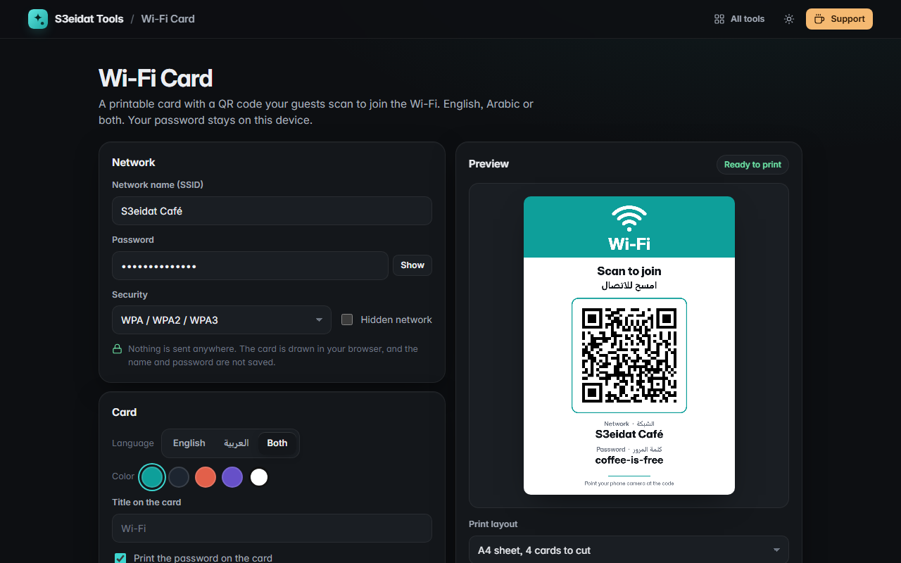

# Wi-Fi Card

> A printable Wi-Fi card with a QR code your guests scan to join. Free, private, and it runs entirely in your browser.

### ▶ [Open Wi-Fi Card](https://s3eidat.github.io/wifi-card/)



## Features

- Network name, password, security (WPA/WPA2/WPA3, WEP or open) and hidden-network flag, encoded in the standard
  `WIFI:` format that iPhone and Android cameras understand
- A designed card with "Scan to join" in **English, Arabic or both**, the network name and (optionally) the password
- Five colors, including an **ink-saver** outline style
- Print as an **A6 card**, an **A4 poster**, or an A4 sheet of **4** or **9** cards with dashed cut lines; "Save as PDF" works too
- Download the card as a high-resolution **PNG** (1240 × 1754, about 300 dpi at A6)
- Warns about a WPA password shorter than 8 characters

## Privacy

Your network name and password never leave your device and are not saved. There is no server, no account, no analytics.
The page ships with a strict Content-Security-Policy (`connect-src 'self'`), so the browser itself blocks any attempt to send
data anywhere. Only your card style (language, color, layout) is remembered in this browser.

## Run it yourself

It's plain HTML, CSS and JavaScript with no build step:

```bash
git clone https://github.com/s3eidat/wifi-card
cd wifi-card
python -m http.server 8000
```

Then open http://localhost:8000.

## Credits

QR matrix encoding by [qrcode-generator](https://github.com/kazuhikoarase/qrcode-generator) (Kazuhiko Arase, MIT), shipped in `lib/`.

## Support

If this saved you time, **[buy me a coffee ☕](https://s3eidat.github.io/coffee/)**. It keeps every tool free.

---

Part of **[S3eidat Tools](https://s3eidat.github.io/)**: 100+ free, private tools that run in your browser. MIT licensed.
